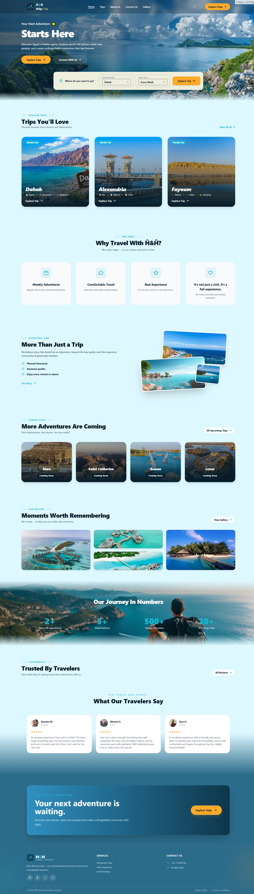
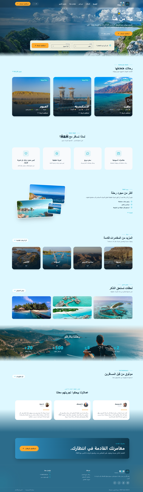
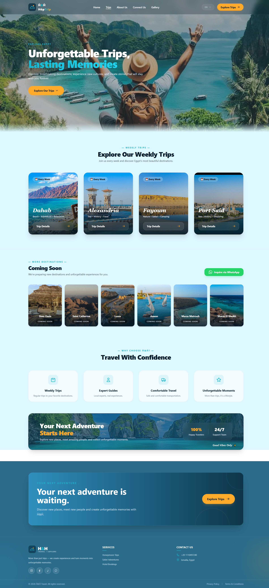
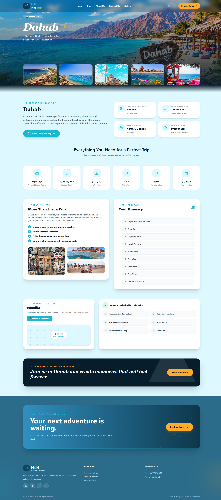
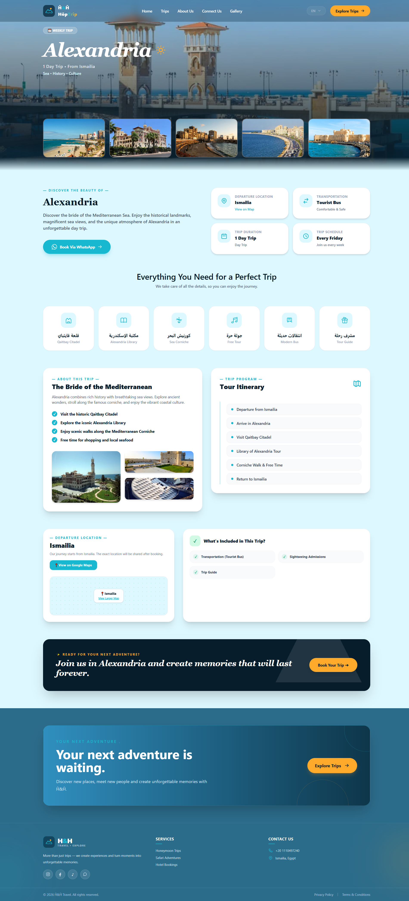
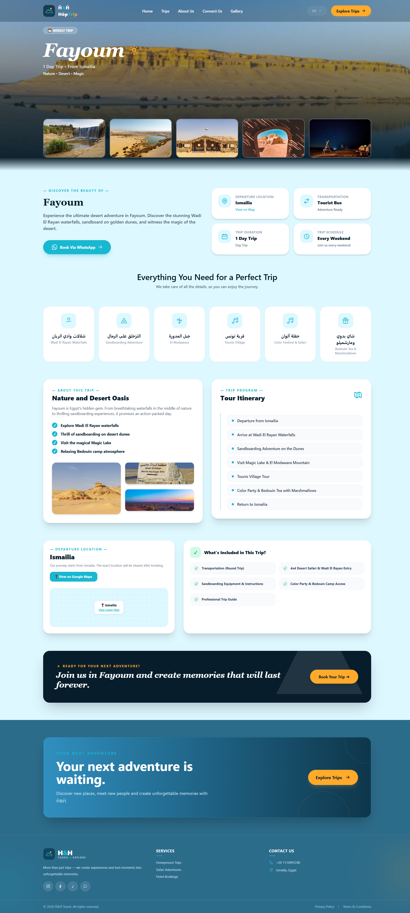
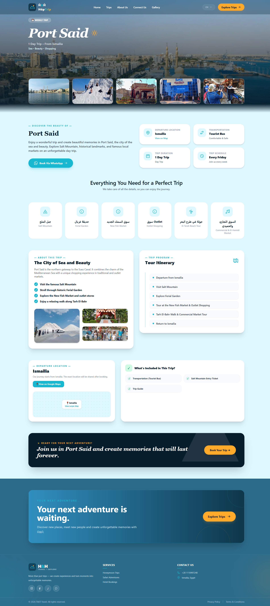
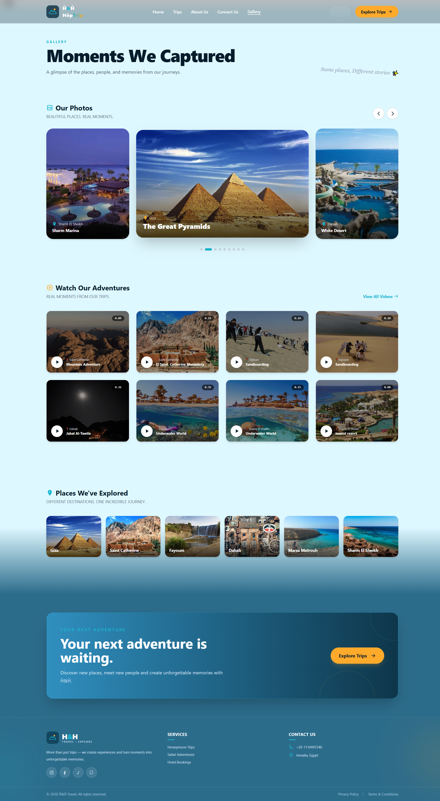
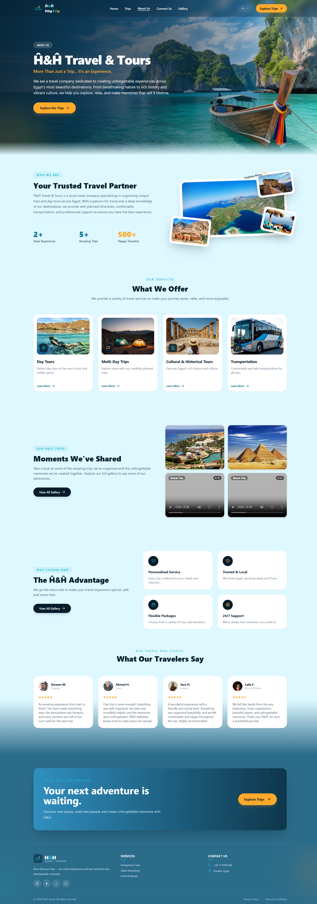
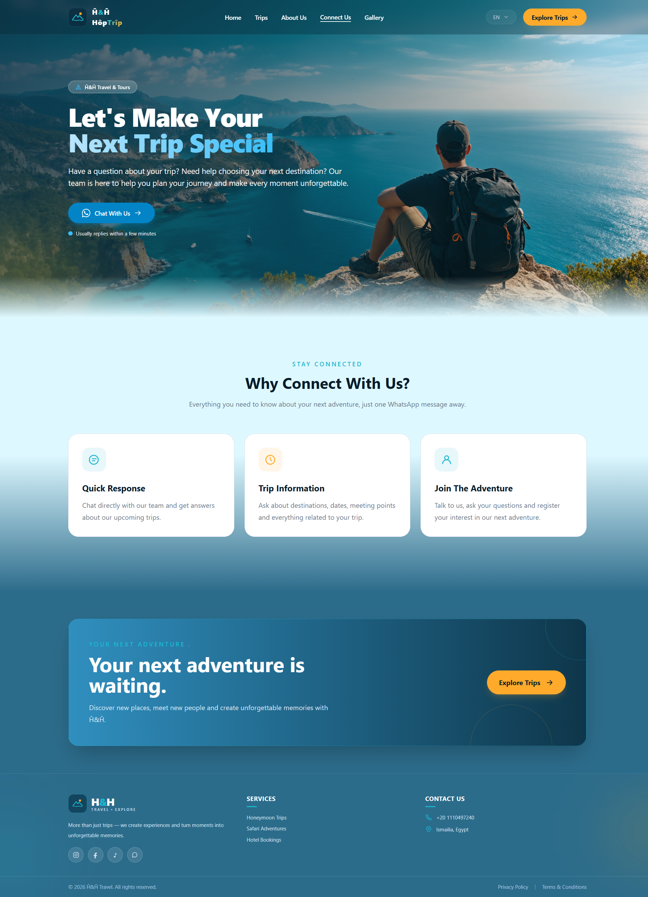

# 🌍 Ĥ&Ĥ HôpTrîp — Travel & Exploration Platform

---

## 🌟 Overview

**Ĥ&Ĥ HôpTrîp** is a modern and responsive travel website designed to inspire travelers to explore destinations, discover exciting trips, and create unforgettable memories.

The platform provides an engaging user experience through visually appealing layouts, destination showcases, detailed trip information, and a travel gallery. Built with Angular and Tailwind CSS, the website focuses on clean UI/UX, reusable components, and accessibility across different screen sizes.

---

## 🚀 Features

### 🏠 Home Page
- Modern landing page with an immersive travel-inspired hero section.
- Attractive calls to action for exploring trips and contacting the team.
- Sections highlighting the travel experience and available destinations.
- Consistent visual identity with a custom color palette.

### 🧭 Trips & Destinations
- Explore featured travel destinations and organized trips.
- Dedicated sections for regular trips and upcoming destinations.
- Detailed trip pages with destination information and itineraries.
- Quick access to trip locations and booking inquiries.

### 📍 Trip Details
- Destination banners and travel photography.
- Trip duration, departure point, and essential information.
- Organized itineraries and trip highlights.
- Information about trip features and inclusions.
- WhatsApp integration for booking inquiries.

### 🖼️ Travel Gallery
- Explore travel photos and captured memories.
- Dedicated sections for photos, videos, and visited places.
- Visually engaging presentation of travel experiences.

### ℹ️ About & Contact
- Learn more about H&H Travel & Tours.
- Discover the team's services and travel experiences.
- Contact section for questions and trip inquiries.

### 🌐 Localization
- Arabic and English language support.
- Dynamic translation using ngx-translate.
- Localized interface content for a more accessible user experience.

### 📱 Responsive Design
- Optimized layouts for desktop, tablet, and mobile devices.
- Responsive navigation and content sections.
- Consistent styling across different screen sizes.

---

## 📸 Screenshots

> Add screenshots of your actual website in the `screenshots` folder.

### 🏠 Home Page

,


### 🧭 Trips Page



### 📍 Trip Details

,
,
,


### 🖼️ Gallery



### ℹ️ About



### ℹ️ Contact


---

## 🛠️ Technologies Used

### Frontend
- **Angular** — Component-based frontend framework.
- **TypeScript** — Type-safe application development.
- **Tailwind CSS** — Utility-first responsive styling.
- **HTML5** — Semantic page structure.
- **SCSS** — Component styling and customization.
- **ngx-translate** — Internationalization and language switching.
- **Flowbite** — UI components and interactive elements.

### Development Tools
- Node.js
- npm
- Angular CLI
- Git & GitHub

---

## 💻 Installation & Setup

### Prerequisites

Make sure you have the following installed:

- Node.js and npm
- Angular CLI (optional if using `npx ng`)
- Git

### 1. Clone the Repository

```bash
git clone https://github.com/kareemhosssm/-H-pTr-p.git
```

### 2. Navigate to the Project Directory

```bash
cd hh-travel-tours
```

### 3. Install Dependencies

```bash
npm install
```

### 4. Run the Development Server

```bash
npx ng serve
```

Open your browser and navigate to:

```text
http://localhost:4200/
```

> If the project uses Angular SSR, follow the production or SSR-specific start command configured in `package.json` when deploying.

---

## 📁 Project Structure

```text
src/
├── app/
│   ├── core/
│   ├── layouts/
│   ├── pages/
│   └── shared/
├── assets/
├── styles.scss
└── main.ts

public/
└── assets/
```

*The structure above is a high-level overview; update it if your actual project folders differ.*

---

## 👨‍💻 Project Contributors

**Kareem Mohamed** — Frontend Developer

Responsible for the Angular application, UI/UX implementation, reusable components, responsive layouts, localization, and client-side functionality.

---

## 🎯 Project Goal

The goal of Ĥ&Ĥ HôpTrîp is to deliver an attractive and user-friendly digital travel experience that helps visitors discover destinations, explore trips, and connect with the travel team.

---

## 📌 Future Improvements

- Deploy the website and provide a live demo.
- Improve loading states and error handling.
- Add further accessibility enhancements.
- Expand destination and trip content.

---

⭐ If you find this project interesting, consider giving the repository a star!

**Built with ❤️ using Angular and Tailwind CSS.**
